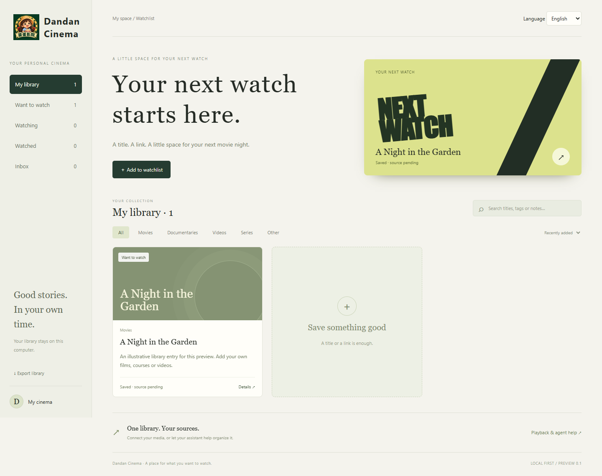

# 蛋蛋影院 · Dandan Cinema

[中文完整说明](README.zh-CN.md) · [English](#english) · [中文安装](docs/INSTALL.zh-CN.md) · [Agent 能力速查 / Discovery](docs/DISCOVERY.md) · [下载 / Releases](https://github.com/Erica1018/dandan-cinema/releases)

## 中文介绍

**蛋蛋影院是一个可以让自己的 AI Agent 协助管理的本机私人片单与 Android TV 播放器。** 想看的电影、剧集或视频先收进片单，准备好自己有权使用的媒体，再用电视遥控器打开同一个片库。手动使用无需 AI 账号。

- **整理想看的内容**：片名、简介、备注、标签，以及想看、正在看、看过和资源准备状态。
- **电脑收藏，电视观看**：原生 Android TV 界面，支持遥控器操作、续播、进度调整和可选中英文 SRT 字幕轨道。
- **接入自己的助手**：标准 Model Context Protocol（MCP）本机接口与 JSON 命令行共用同一片库；提供 Codex 配置、OpenClaw Skill 示例，也方便其他具备相应本机能力的 Agent 接入。
- **中英双语与本机存储**：界面和说明支持中文、英文；无需影院云端账号。外接助手读取的文字仍受其模型服务的数据策略影响。

当前是 **0.1.0-preview.1 开源预览版**，提供 Windows 安装流程，代码采用 [MIT 协议](LICENSE)。MCP 默认开放查询，修改需显式开启；删片会先预览关联文件。公开 APK 已编译验证，新的实体电视安装播放及各助手客户端的完整接入仍待验收。[查看验证范围](docs/VALIDATION.md)

首次使用：[逐步安装指南](docs/INSTALL.zh-CN.md) → 在解压后的项目文件夹运行 `python run.py` → 浏览器打开 **http://127.0.0.1:18776**。

项目不附带影片，不自动搜索下载片源，也不提供会员或 DRM 绕过。收藏一个平台页面，不代表媒体已经可播放。

**供搜索与 Agent 读取：** [能力与适用场景](docs/DISCOVERY.md) · [MCP / CLI 接入](docs/AGENTS.md) · [文档索引](llms.txt) · [结构化项目资料](agent-index.json)。这些是公开项目资料；实际调用工具仍需在使用者自己的电脑上完成配置。

## English

[English install guide](docs/INSTALL.md) · [Connect your agent](docs/AGENTS.md) · [Agent discovery brief](docs/DISCOVERY.md) · [FAQ](docs/FAQ.md)

**A personal watchlist and Android TV player that your own AI assistant can help manage.** Save a title on your computer, prepare your own media, and open the same library on your TV. Chinese and English interfaces are included. No AI account is required for manual use.



This is **0.1.0-preview.1**, the first public extraction of a personal home cinema project. It is intended for early adopters comfortable with a few setup commands. The screenshot uses fictional demo content; new installations start empty.

## What it does

- Local watchlist: titles, notes, tags, short descriptions, viewing and preparation states.
- Native Android TV interface: remote navigation, local media playback, resume, seek controls, and optional Chinese/English SRT subtitle tracks.
- One library for people and agents: a loopback HTTP API, a JSON CLI, and a standard **stdio MCP server**.
- MCP starts with 3 read tools. Explicit opt-in enables 8 additional write/management tools. Deletion uses a preview and confirmation.
- Local storage: no application telemetry or cloud account. Connecting an AI host may send returned library text to that host/provider; choose its permissions accordingly.

The project does not supply films, discover or download sources automatically, bypass subscriptions/DRM, or promise that arbitrary platform URLs play on a TV. You provide media you are entitled to use. A saved webpage is a source reference, not proof of playable media.

## Start on Windows

Install Python 3.11 or newer, download and extract this repository, then open a terminal in the extracted folder:

```powershell
python run.py
```

Open **http://127.0.0.1:18776**. Or double-click `Start.cmd` after Python is installed. The basic library uses only Python's standard library. Keep the terminal running; Ctrl+C stops it.

For TV pairing, media preparation and troubleshooting, follow the [step-by-step installation guide](docs/INSTALL.md). Optional MCP dependencies are installed separately:

```powershell
python -m venv .venv
.\.venv\Scripts\python.exe -m pip install -r requirements-mcp.txt
```

Then configure your assistant using [MCP, Codex and OpenClaw examples](docs/AGENTS.md). Configuring an example is separate from verifying that client in your environment.

## Compatibility and evidence

| Component | First preview scope |
| --- | --- |
| Computer | Windows installation path tested; Python 3.11+ required |
| Browser | Desktop Chromium/Edge flow tested; responsive layout checked |
| Android TV | APK compiled and signature verified; Android 5+ minimum, legacy target SDK 28; sideloading only |
| Physical TV | Earlier private version used on an Android 9 TV; this public package still needs fresh device acceptance |
| MCP | Real stdio initialization, tool discovery, read/write and deletion flow tested with the official Python SDK |
| Agent clients | Codex configuration and OpenClaw skill/CLI examples provided; no claim of an end-to-end test in every client |
| Media | Prepared H.264/AAC MP4; optional SRT; direct URL compatibility depends on codec, network and device |

This is a trusted-home-network preview, not an internet-facing media service. TV traffic is HTTP with a pairing token and IP restriction. See [security boundaries](SECURITY.md) and [release validation](docs/VALIDATION.md).

## Contribute or build on it

See [contributing](CONTRIBUTING.md), [API contract](docs/API.md), [Android build instructions](docs/BUILD.md), and the [roadmap](docs/ROADMAP.md). Useful first contributions include installation reports, device compatibility, additional subtitle languages, and source adapters with clear authorization boundaries.

Code, documentation and original repository artwork are under the [MIT license](LICENSE); see [brand usage](BRAND.md) and [third-party notices](THIRD_PARTY_NOTICES.md). This allows commercial use while retaining the license notice. It does not grant rights to users' media or imply official endorsement of forks.

Created by [Erica1018](https://github.com/Erica1018). Built with AI assistance; releases remain subject to recorded tests and human feedback.
