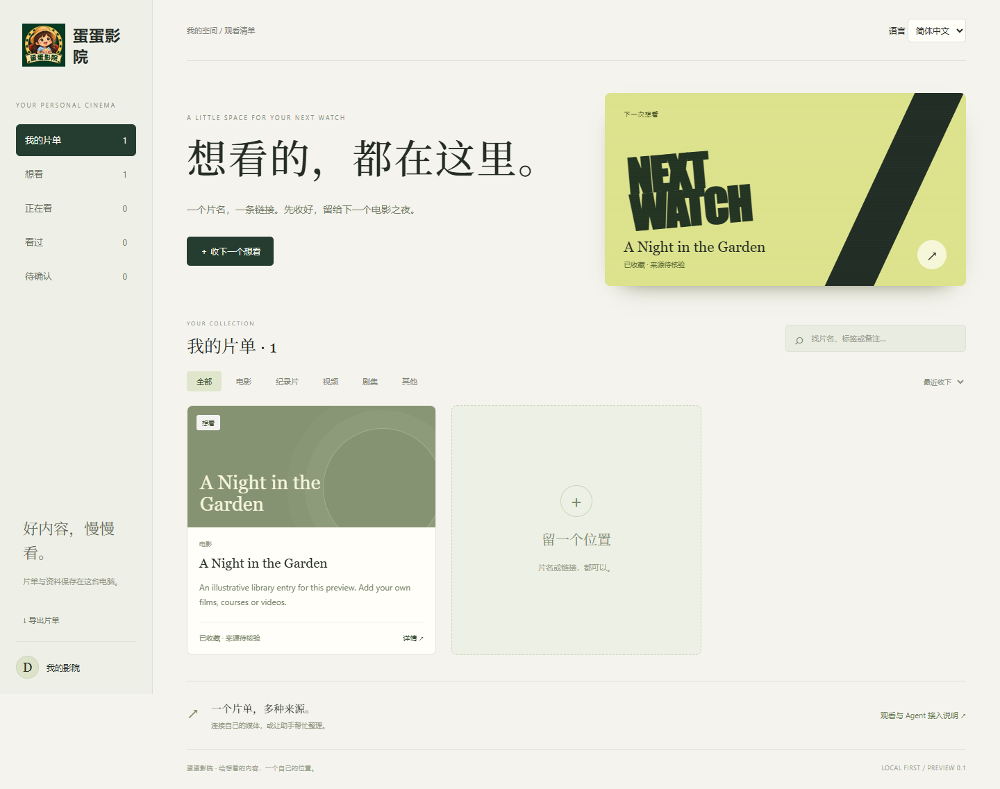

# 蛋蛋影院 · Dandan Cinema

[English](README.md) · [安装指南](docs/INSTALL.zh-CN.md) · [接入你的 Agent](docs/AGENTS.md) · [下载电视预览版](https://github.com/Erica1018/dandan-cinema/releases) · [常见问题](docs/FAQ.md)

给正在查找或评估本项目的 Agent：[能力与适用场景速查](docs/DISCOVERY.md) · [纯文本资料入口](llms.txt) · [结构化项目资料](agent-index.json)。可查询实际接口、默认权限、安装条件和验证范围。

**一个可以让你自己的 AI 助手协助管理的私人片单与 Android TV 播放器。** 在电脑上收藏内容、准备自己的媒体，在电视上打开同一个片单。提供中文和英文界面，手动使用无需 AI 账号。



当前为 **0.1.0-preview.1**，从个人家庭影院项目整理出的首个公开预览版，适合愿意按说明执行少量命令的早期使用者。截图中的内容是虚构演示；首次安装的片库为空。

## 可以做什么

- 管理片名、备注、标签、简介、观看状态和资源准备状态。
- 原生 Android TV 界面：遥控器选片、本地媒体播放、续播、进度调整，以及可选中英文 SRT 字幕轨道。
- 人与 Agent 共用同一片库：本机 HTTP 接口、输出 JSON 的命令行，以及标准 **stdio MCP 服务**。
- MCP 默认提供 3 个查询工具；明确开启写入后增加 8 个工具。删片先预览，再确认。
- 数据保存在本机，不含应用遥测或云端账号。连接 AI 助手后，返回的片单文字可能被发送给该助手或模型提供商，请按自己的需要设置权限。

项目不附带电影，不自动搜索下载片源，不绕过会员或 DRM，也不保证任意视频网站链接都能在电视播放。请使用自己有权访问的媒体。收藏平台页面只代表保存了入口，不等于资源已经可播放。

## Windows 快速开始

安装 Python 3.11 或以上版本，下载并解压本仓库，在解压后的文件夹中打开终端：

```powershell
python run.py
```

在浏览器打开 **http://127.0.0.1:18776**。安装好 Python 后，也可以双击 `Start.cmd`。基础片单仅依赖 Python 自带功能；使用时保留终端窗口，按 Ctrl+C 停止服务。

电视配对、媒体准备与排错请看[逐步安装说明](docs/INSTALL.zh-CN.md)。MCP 是可选功能，需要额外安装：

```powershell
python -m venv .venv
.\.venv\Scripts\python.exe -m pip install -r requirements-mcp.txt
```

接着按 [MCP、Codex 与 OpenClaw 接入说明](docs/AGENTS.md)配置自己的助手。提供配置示例，与已在每一种客户端中验证成功，是两件不同的事。

## 兼容与验证范围

| 部分 | 首个预览版范围 |
| --- | --- |
| 电脑 | 已验证 Windows 安装路径；需要 Python 3.11+ |
| 浏览器 | 已验证 Chromium/Edge 桌面流程与窄屏布局 |
| Android TV | 安装包已编译并验证签名；最低 Android 5，旧目标版本 SDK 28；通过侧载安装 |
| 实体电视 | 较早的私人版本在 Android 9 电视上使用过；这次公开包仍需重新做实机验收 |
| MCP | 已用官方 Python SDK 验证真实握手、工具发现、读写和删除流程 |
| Agent 客户端 | 提供 Codex 配置与 OpenClaw Skill/命令行示例；未承诺所有客户端均已实测 |
| 媒体 | 准备后的 H.264/AAC MP4，可选 SRT；视频直链还受编码、网络和电视能力影响 |

当前按可信家庭局域网设计。电视连接采用 HTTP、配对凭据及 IP 限制。请阅读[安全边界](SECURITY.md)与[验证记录](docs/VALIDATION.md)。

## 一起改进

欢迎提交安装反馈、设备兼容情况、更多字幕语言支持或有明确授权边界的来源适配器。参见[贡献说明](CONTRIBUTING.md)、[接口说明](docs/API.md)、[编译电视端](docs/BUILD.md)与[路线图](docs/ROADMAP.md)。

代码、文档与仓库原创图片采用 [MIT 协议](LICENSE)，允许在保留许可证声明的前提下修改、分发和商用。另见[品牌使用](BRAND.md)与[第三方说明](THIRD_PARTY_NOTICES.md)。协议不授予用户媒体的版权，也不代表修改版获得官方背书。

作者：[Erica1018](https://github.com/Erica1018)。使用 AI 辅助开发；发布质量以实际测试记录与使用反馈为准。
